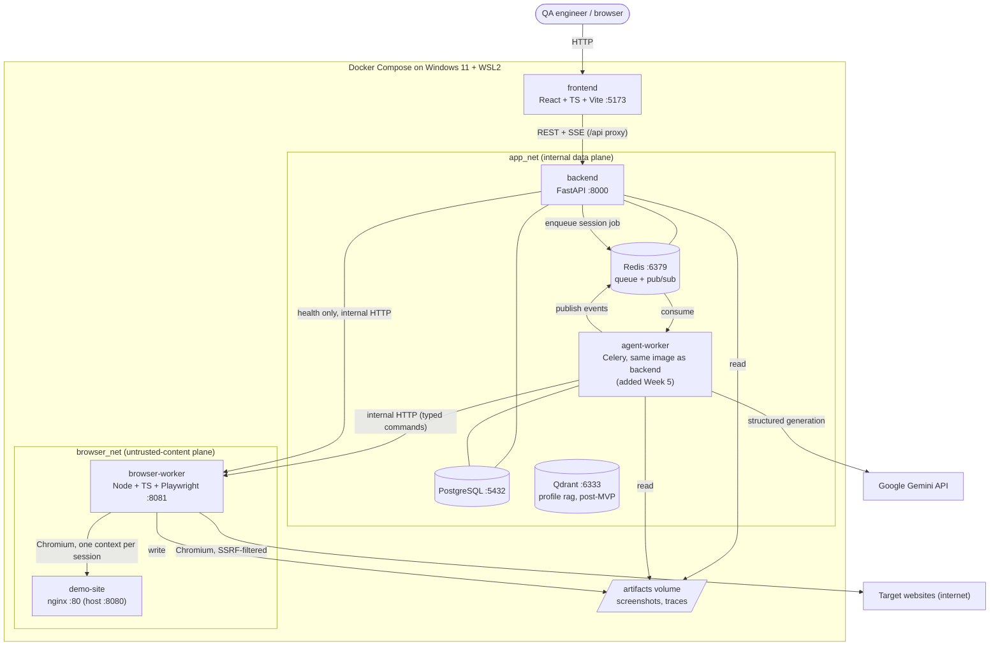
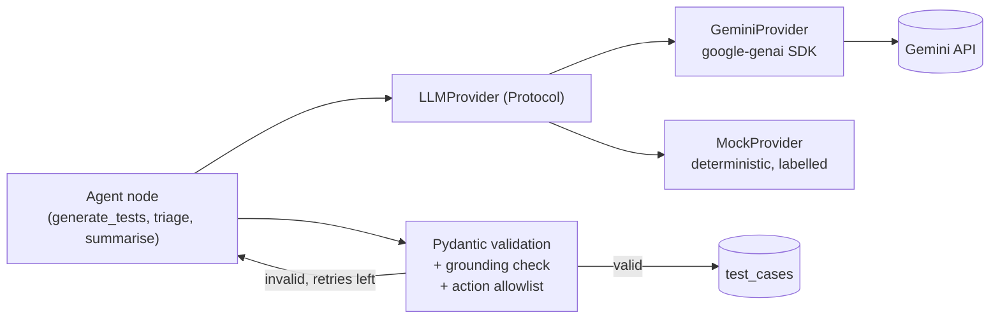
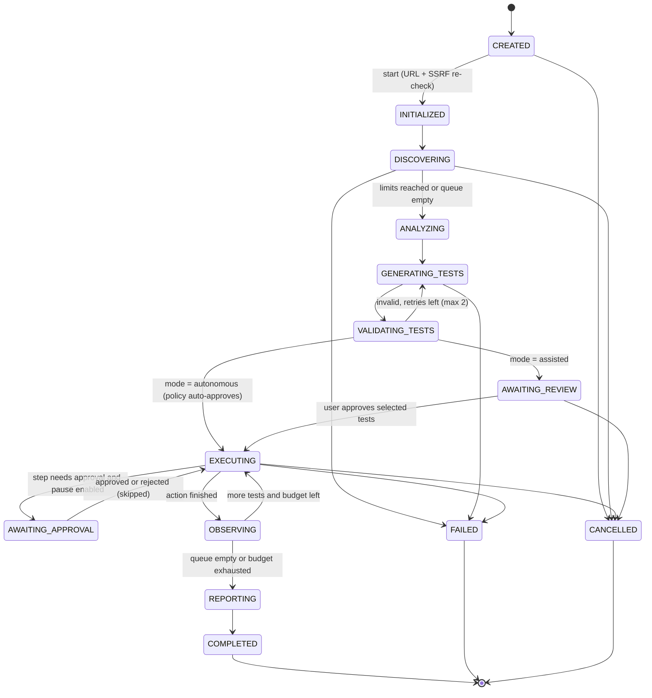
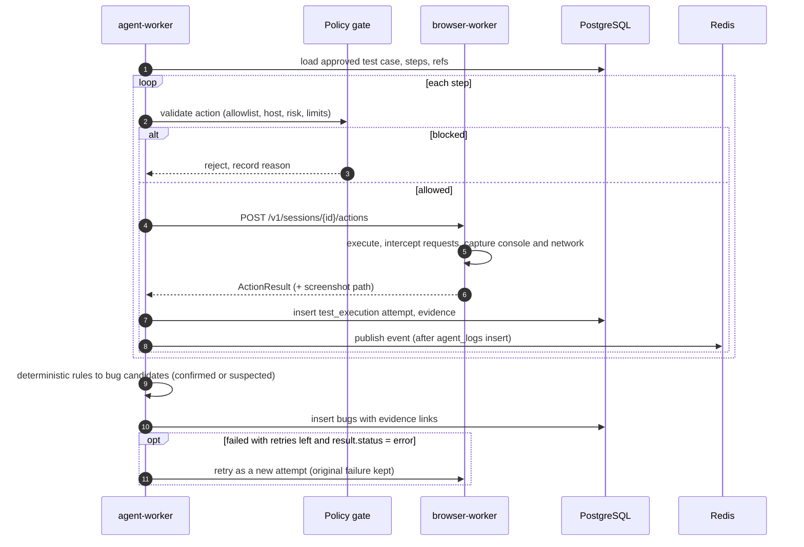

# Sentinel AI: Architecture

Status: **Final for MVP (Phase 0 complete).** Companion documents: [database.md](database.md), [security.md](security.md), [technology_decisions.md](technology_decisions.md), [implementation_plan.md](implementation_plan.md).

## 1. What we are building

Sentinel AI takes a website URL, explores it in a real browser, asks an LLM (Google Gemini) to propose test cases grounded in what was actually found, executes the approved cases with deterministic Playwright code, and produces evidence-backed bug reports.

> **Core principle: the LLM proposes; deterministic code decides.**

| The LLM may | Deterministic code must |
|---|---|
| Suggest test cases and priorities | Validate URLs and enforce SSRF protection |
| Suggest expected outcomes | Validate every browser action against an allowlist |
| Explain a failure in plain language | Execute Playwright operations |
| Draft the human-readable report summary | Evaluate assertions and decide pass/fail |
| Propose a suggested fix | Collect evidence, enforce limits, persist results |

The LLM never emits selectors, JavaScript, or shell commands. It refers to page elements by opaque **element refs** (`el_12`) taken from the element inventory the worker built. The backend maps a ref to a Playwright locator. A hallucinated ref cannot be mapped, so the test is rejected at validation.

## 2. Container view



Key points:

- **Two networks.** The browser-worker (the only component that touches untrusted websites) is on `browser_net` only. It cannot reach PostgreSQL, Redis, or Qdrant at the network level, and it holds no secrets. The backend and agent-worker join both networks so they can talk to it.
- **No microservice sprawl.** Five application services (frontend, backend, agent-worker, browser-worker, demo-site) plus Postgres and Redis. Qdrant sits behind a Compose profile and is off by default.
- **The `agent-worker` is the backend image with a different command.** It is not a new codebase.

## 3. Component responsibilities

| Component | Owns | Must not |
|---|---|---|
| **frontend** | UI, polling and SSE consumption, review/approval UX | Hold API keys; call Gemini or the worker directly |
| **backend (API)** | AuthN/Z, REST API, validation, persistence, enqueueing jobs, SSE fan-out, report assembly | Run a browser or a long agent loop inside a request |
| **agent-worker** | Runs the LangGraph session workflow; calls Gemini and the browser-worker; writes results | Execute LLM output as code; skip the policy gate |
| **browser-worker** | Playwright execution, per-session isolation, element inventory, console/network capture, screenshots/traces, in-browser SSRF interception | Talk to the database; store secrets; accept raw JS or selectors outside the typed contract |
| **PostgreSQL** | All application metadata ([database.md](database.md)) | Store screenshots or traces as blobs |
| **Redis** | Job queue; pub/sub for live events | Be the system of record (events are persisted to `agent_logs` first) |
| **demo-site** | Controlled target with seeded defects and ground-truth labels | Be reachable by anything but the worker (and the developer's host browser) |
| **Qdrant** | Reserved for post-MVP RAG | Be started in MVP |

Backend internal layering (kept shallow on purpose): `api/` (thin routers) → `services/` (business logic) → `database/` (session and repositories) with `core/` (config, logging, security, SSRF) and `llm/`, `agents/`, `tools/`, `browser/` (worker HTTP client) as later milestones land.

## 4. API boundaries

### 4.1 Backend REST (frontend → backend)

All routes live under `/api`. OpenAPI is served at `/api/docs`.

| Milestone | Endpoints |
|---|---|
| Week 1 (done) | `GET /api/health`, `GET /api/health/ready` |
| Week 2 | `POST /api/auth/register`, `POST /api/auth/login`; `POST /api/projects`, `GET /api/projects`; `POST /api/sessions` (URL validation and SSRF check happen here), `GET /api/sessions`, `GET /api/sessions/{id}`, `GET /api/sessions/{id}/pages` |
| Week 3 | `POST /api/sessions/{id}/generate-tests`, `GET /api/sessions/{id}/tests`, `PATCH /api/tests/{id}` (edit/approve/reject) |
| Week 4 | `POST /api/tests/{id}/run`, `GET /api/tests/{id}/executions`, `GET /api/artifacts/{id}` (authorised file download) |
| Week 5 | `POST /api/sessions/{id}/start`, `POST /api/sessions/{id}/cancel`, `POST /api/approvals/{id}/decision`, `GET /api/sessions/{id}/bugs`, `PATCH /api/bugs/{id}`, `GET /api/sessions/{id}/report` (JSON) |
| Week 6 | `GET /api/sessions/{id}/events` (SSE), `GET /api/dashboard/summary` |

### 4.2 Live updates

`GET /api/sessions/{id}/events` is Server-Sent Events. Every event is **written to `agent_logs` first, then published to Redis**. A reconnecting client sends `Last-Event-ID` and receives the missed rows from Postgres before switching to the live stream. The browser's native `EventSource` cannot send an `Authorization` header, so the frontend uses a fetch-based SSE reader. Commands (cancel, approve) are always plain REST calls.

### 4.3 Browser-worker contract (agent-worker → browser-worker)

Internal HTTP + JSON. Everything except the health endpoints requires the `X-Worker-Token` shared secret (implemented in Week 2 when the first real endpoint appears). The contract is defined with Zod schemas in the worker and mirrored by Pydantic models in the backend, with a contract test on each side.

| Method and path | Purpose | Milestone |
|---|---|---|
| `GET /health` | Liveness (no browser launch) | Week 1 (done) |
| `GET /health/ready` | Launches headless Chromium, opens `about:blank`, closes (cached 30 s) | Week 1 (done) |
| `POST /v1/sessions` | Create an isolated `BrowserContext` with allowed hosts, viewport, limits | Week 2 |
| `DELETE /v1/sessions/{id}` | Destroy the context and free resources | Week 2 |
| `POST /v1/sessions/{id}/discover` | Bounded crawl → list of `PageSnapshot` | Week 2 |
| `POST /v1/sessions/{id}/actions` | Execute **one** typed action → `ActionResult` | Week 4 |
| `POST /v1/sessions/{id}/screenshots` | Capture a labelled screenshot | Week 4 |
| `POST /v1/sessions/{id}/trace/start`, `/trace/stop` | Playwright trace for a test execution | Week 4 |

**Locator** (preference order mirrors Playwright best practice):

```jsonc
{ "strategy": "role",        "role": "button", "name": "Log in", "exact": true }
{ "strategy": "label",       "text": "Email" }
{ "strategy": "placeholder", "text": "Search products" }
{ "strategy": "text",        "text": "Add to cart" }
{ "strategy": "testid",      "id": "checkout-btn" }
{ "strategy": "css",         "selector": "form#login input[type=email]" } // fallback only
```

**Action allowlist** (a discriminated union on `type`; anything else is rejected with HTTP 422):
`navigate`, `click`, `fill`, `select_option`, `check`, `uncheck`, `press_key`, `wait_for_url`, `assert_visible`, `assert_hidden`, `assert_text`, `assert_url`, `assert_count`, `assert_no_page_errors`, `assert_images_loaded`.

**PageSnapshot** (output of discovery): `url`, `finalUrl`, `status`, `title`, `depth`, `elements[]` (`ref`, `tag`, `role`, `accessibleName`, `label`, `placeholder`, `inputType`, `text`, `href`, `locator`, `safety` ∈ `safe | needs_approval | blocked`, `safetyReason`), `forms[]`, `links[]`, `images[]` (`src`, `loaded`), `consoleErrors[]`, `screenshotPath`.

**ActionResult**: `status` ∈ `passed | failed | error`, `durationMs`, `urlAfter`, `console[]`, `pageErrors[]`, `failedRequests[]`, `httpErrors[]` (each with `isNavigation`), `assertion` (`expected`, `actual`, when applicable), `error` (class and message), `screenshotPath?`.

The worker classifies `error` (infrastructure/timeout/target unreachable) separately from `failed` (an assertion evaluated and was false). Only `error` is eligible for automatic retry.

## 4.4 Gemini integration design



- **Interface:** `LLMProvider.generate_structured(request: LLMRequest, schema: type[BaseModel]) -> LLMResult[T]`. `LLMResult` carries the parsed object, token usage, latency, model name, and `source` (`"gemini"` or `"mock"`).
- **Config:** `LLM_PROVIDER` (`gemini` | `mock`), `GEMINI_API_KEY`, `GEMINI_MODEL`. Selecting `gemini` without a key fails at startup with a clear message. The default model name is a configurable placeholder that must be confirmed against current Gemini documentation in Week 3.
- **Structured output:** JSON mode with a response schema, then Pydantic validation anyway. The provider's schema enforcement is a hint, never trusted.
- **Errors:** typed exceptions (`LLMRateLimitError`, `LLMTimeoutError`, `LLMProviderError`, `LLMInvalidResponseError`). Rate limits and timeouts get exponential backoff with jitter and a hard attempt cap. Invalid output gets at most 2 regeneration attempts, then the session records a validation failure instead of looping.
- **Budget:** per-session token and call ceilings (configurable). Exceeding them moves the session to `FAILED` with a clear reason.
- **Mock:** `MockProvider` returns schema-valid canned output and stamps `source="mock"` on everything it produces. The UI shows a visible "Mock data" badge. Automated tests only ever use the mock or recorded fixtures, never a paid call.
- **Prompt-injection posture:** page content is passed as quoted data inside delimited blocks, with an instruction that it is untrusted. This is a speed bump, not a defence. The actual defences are in code: output is schema-validated, steps may only use allowlisted action types and refs from the inventory, and the policy gate runs on every action regardless of what the model said. See [security.md](security.md).

## 5. Session workflow (LangGraph)

The workflow is a bounded state machine. Both modes share every node except the review gate.



**Where the LLM is involved:** `GENERATING_TESTS` (propose cases), an optional priority pass, an optional failure-triage note, and `REPORTING` (summary text). **Where it is not:** selecting the next test (deterministic priority queue), executing actions, evaluating assertions, classifying severity. LLM triage output is stored as `llm_assessment` and never changes a pass/fail status.

**Bounds (enforced in the routing function, not by the LLM):** `max_iterations`, `max_duration_seconds`, `max_pages`, `max_depth`, `max_tests`, `max_retries_per_test` (default 1), token budget. Cancellation is a database flag (`cancel_requested`) checked between every step, so it is cooperative and reliable. Graph state is checkpointed so an approval can pause a session and resume it.

**Modes**

- **AI-Assisted:** pauses in `AWAITING_REVIEW`. The user edits, approves or rejects each generated case. Only approved cases run.
- **Autonomous:** the policy gate approves cases classified `safe`. Cases that need approval (for example, submitting a state-changing form) are marked `skipped_needs_approval` by default, or pause in `AWAITING_APPROVAL` if the session is configured to wait for a human. Blocked cases never run.

**Documented limitation:** "autonomous" here means *autonomous within a plan the system generated and a policy it cannot widen*. It is not open-ended browsing by the model.

## 6. Execution lifecycle (single test case)



Every attempt is its own `test_executions` row. A retry never overwrites the first failure, and a test that fails then passes is flagged `flaky`.

## 7. Repository layout

```
sentinel-ai/
├── backend/            FastAPI app, Alembic, pytest
│   ├── app/{api,core,database,models,services}/   (llm/, agents/, tools/, browser/ arrive in Weeks 2-5)
│   ├── alembic/
│   └── tests/{unit,integration}/
├── frontend/           React + TS + Vite + Tailwind + Vitest
├── browser-worker/     Fastify + TS + Playwright + Vitest
├── demo-site/          static nginx site with seeded defects
├── infrastructure/     docker/, scripts/
├── docs/               this directory
├── .github/workflows/ci.yml
├── docker-compose.yml
├── .env.example
├── DEVELOPMENT_STATUS.md
└── README.md
```

## 8. Changes from the original Phase 0 proposal

Recorded so the documents stay honest about what moved and why.

| Change | Reason |
|---|---|
| Celery worker introduced in Week 5, not Week 1 | Nothing enqueues jobs until the agent exists; Week 1 only needs Redis connectivity |
| Qdrant behind Compose profile `rag` | Reserved for post-MVP; avoids RAM cost and startup noise |
| `screenshots` merged into `evidence` | One table for screenshots, traces, logs; fewer joins |
| `visual_baselines`, `visual_diffs`, `evaluation_results`, `historical_knowledge` deferred | Post-MVP features (see implementation plan) |
| Health routes under `/api/health` | Everything behind one `/api` proxy prefix |
| One PostgreSQL driver (`psycopg` v3, sync for Alembic and async for the app) | Avoids maintaining asyncpg + psycopg2 |
| LLM refers to element refs, never selectors | Makes hallucinated targets structurally invalid |
| Added `AWAITING_REVIEW` and `AWAITING_APPROVAL` states, plus `CREATED` | Needed for AI-Assisted mode and approvals |
| Two Docker networks | Gives the browser-worker real network-level isolation from the data plane |
| `sentence-transformers` embeddings deferred with RAG | Not needed until the RAG phase |
