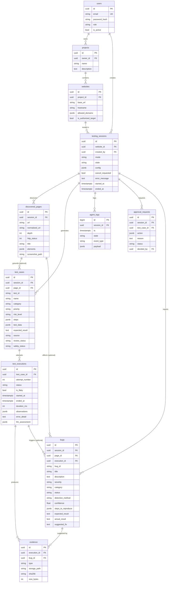

# Sentinel AI: Database Design

PostgreSQL 16, SQLAlchemy 2.x (typed `Mapped[]` models), Alembic migrations, `psycopg` v3 driver (`postgresql+psycopg://`).

## 1. Conventions

- Primary keys are `UUID` (generated server-side with `gen_random_uuid()`, built into PostgreSQL 13+).
- Every table has `created_at timestamptz NOT NULL DEFAULT now()`. Mutable tables also have `updated_at`.
- Enumerations are stored as `VARCHAR` with a `CHECK` constraint (SQLAlchemy `Enum(native_enum=False)`), not native PostgreSQL enums, because adding a value to a native enum is awkward in migrations.
- Flexible payloads (`config`, `elements`, `steps`) use `JSONB`. Anything we filter or join on is a real column.
- Screenshots, traces and logs are **files**, referenced by path and SHA-256. Binary data is never stored in PostgreSQL.
- Foreign keys declare an explicit `ON DELETE` rule. Deleting a user or project cascades down to its sessions and results.
- Email is unique case-insensitively through a unique index on `lower(email)`.

## 2. Entity-relationship diagram

Tables are tagged with the milestone that introduces them. The ERD below is the target MVP schema.

## 3. Table notes

| Table | Introduced | Notes |
|---|---|---|
| `users` | Week 1 | Argon2 password hash (Week 2 auth). `role` ∈ `user`, `admin` |
| `projects` | Week 1 | Unique `(owner_id, name)` |
| `websites` | Week 1 | `hostname` is the normalised host used for allowlist checks. `is_authorized_target` records the user's confirmation that they may test this site. Unique `(project_id, base_url)` |
| `testing_sessions` | Week 1 | `state` holds the workflow state. `config` stores limits and selected categories, snapshotted at creation so later setting changes do not alter past runs. `cancel_requested` is the cooperative-cancel flag |
| `discovered_pages` | Week 2 | Unique `(session_id, normalized_url)` gives duplicate-URL protection at the database level. `elements` holds the element inventory (refs, locators, safety classification) |
| `test_cases` | Week 3 | `test_id` is the human ID (`TC_001`), unique per session. `source` ∈ `llm`, `mock`, `user`, which keeps mock output visibly distinct. `review_status` ∈ `pending`, `approved`, `rejected`, `edited`. `safety_status` ∈ `safe`, `needs_approval`, `blocked` is set by the policy gate, never by the LLM |
| `test_executions` | Week 4 | One row per **attempt**. Unique `(test_case_id, attempt_number)`. `status` ∈ `passed`, `failed`, `error`, `skipped`. `is_flaky` is set when an attempt passes after an earlier failure. `llm_assessment` holds optional LLM triage and never affects `status` |
| `evidence` | Week 4 | `type` ∈ `screenshot`, `trace`, `console_log`, `network_log`, `dom_snapshot`. A row links to an execution, a bug, or both. `sha256` makes tampering and duplicates detectable |
| `bugs` | Week 5 | `bug_id` is human-readable (`BUG_001`), unique per session. `status` ∈ `confirmed`, `suspected`, `dismissed`, `fixed`. `detection_method` ∈ `rule`, `llm`, `manual`. `severity` ∈ `critical`, `high`, `medium`, `low`, `info`. A bug may not be `confirmed` without at least one evidence row (enforced in the service layer and covered by a test) |
| `agent_logs` | Week 3 | Append-only. `id` is a `bigserial`, so it doubles as the SSE `Last-Event-ID` |
| `approval_requests` | Week 5 | Human-in-the-loop gate. `status` ∈ `pending`, `approved`, `rejected`, `expired` |

**Deferred tables (post-MVP):** `visual_baselines`, `visual_diffs` (OpenCV/SSIM regression), `evaluation_results` (precision/recall runs), `historical_knowledge` (RAG index metadata). The earlier proposal's `screenshots` table is merged into `evidence`.

## 4. Indexing plan

- `testing_sessions (website_id, created_at DESC)` and `(state)` for list and dashboard queries.
- `discovered_pages (session_id, normalized_url)` unique.
- `test_cases (session_id, test_id)` unique; `(session_id, review_status)`.
- `test_executions (test_case_id, attempt_number)` unique; `(status)`.
- `bugs (session_id, severity)`, `(session_id, status)`.
- `agent_logs (session_id, id)` for ordered replay.
- Add further indexes only when a measured query needs them.

## 5. Migration plan

| Revision | Milestone | Contents |
|---|---|---|
| `0001_initial_core` | Week 1 | `users`, `projects`, `websites`, `testing_sessions` |
| `0002_discovery` | Week 2 | `discovered_pages` |
| `0003_tests_and_logs` | Week 3 | `test_cases`, `agent_logs` |
| `0004_executions_evidence` | Week 4 | `test_executions`, `evidence` |
| `0005_bugs_approvals` | Week 5 | `bugs`, `approval_requests` |

Rules: every revision has a working `downgrade()`. A test applies `upgrade head`, verifies tables exist, runs `downgrade base`, and verifies they are gone. A drift test compares the migrated schema with the SQLAlchemy models (`alembic.autogenerate.compare_metadata`) and fails if they diverge. Migrations run automatically in development Compose. In production they run as an explicit one-shot step.

## 6. Data retention

Screenshots and traces live under the `artifacts` volume at `artifacts/{session_id}/{execution_id}/...`. Paths stored in the database are relative to the artifacts root and are validated on read to prevent path traversal. A retention setting that purges old artifact files is a post-MVP item. Until then, the volume grows and the README documents how to clear it.
